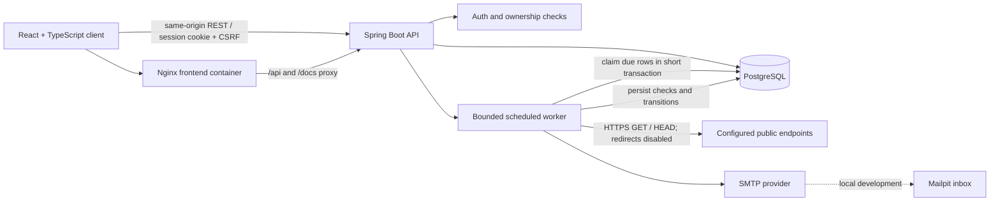

# API Sentinel

API Sentinel is a developer-focused API monitoring workspace. It records scheduled HTTP checks, response latency, and incidents so endpoint failures can be investigated without keeping a browser open.

The repository contains a React/TypeScript client and a Java 17/Spring Boot modular monolith backed by PostgreSQL. This is an early, runnable product foundation rather than a claim that every product item in the original specification is complete. The implemented scope and known gaps are listed below.

## Implemented

- Optional email OTP sign-in and sign-up with one-use, expiring verification codes and HTTP-only session cookies. Verified accounts are persisted in PostgreSQL.
- Persisted account name, time-zone, and incident/recovery email preferences, with an SMTP test-email action that reports unavailable delivery honestly.
- CSRF tokens for state-changing requests; configured-origin CORS.
- Owner-scoped monitor creation, configuration editing, detail views, pause/resume, archive, and paginated check history.
- HTTPS GET/HEAD checks on a bounded backend worker; PostgreSQL row locking claims due monitors before network I/O.
- Expected-status checks, request timeouts, response-body byte cap, redirects disabled, and sanitized failure categories.
- Persistent check records, failure/recovery thresholds, incident deduplication, acknowledgement, uptime calculation, and hourly response-time aggregates.
- Owner-managed public status pages with publication controls and a safe read-only response containing service names, status, uptime, and incident timestamps.
- Optional incident and recovery email through SMTP; notification events run after transaction commit. An empty SMTP host is reported in logs as unconfigured.
- Direct-entry sample workspace, public marketing page at `/welcome`, monitor and incident views, and responsive layouts.
- Flyway migration, H2 integration profile, Docker Compose, Mailpit, OpenAPI UI, and GitHub Actions checks.

The app opens the clearly labelled sample workspace by default. Sample values are not measurements and do not make HTTP requests. Set `VITE_DEMO_MODE=false` to enable the connected OTP account flow instead.

Public status pages are created from `/app/status-pages`; published pages are available at `/status/:slug`.

## Not implemented yet

Account deletion, IP-wide authentication rate limiting, request-history retention/pruning, per-monitor chart analytics, selectable dashboard date ranges, p95 latency, and a demo seed account are not included yet. Time-zone preference is saved and used in the settings account date; broader timestamp localization across every screen remains future work. There is no claim of a penetration test or production deployment.

## Stack

- Frontend: React 19, TypeScript strict mode, Vite, React Router, TanStack Query, Recharts, Lucide, and CSS design tokens.
- Backend: Java 17, Spring Boot 3.5, Spring Web, Security, Data JPA, Bean Validation, Flyway, PostgreSQL, Actuator, springdoc OpenAPI, and JUnit 5.
- Local services: PostgreSQL 17, Mailpit, Docker Compose.

## Architecture



## Local development

Prerequisites: Java 17+, Maven 3.9+, Node.js 22+, npm, and Docker Compose v2.

1. Copy `.env.example` to `.env` and set a local-only `DATABASE_PASSWORD`.
2. Start the integrated stack:

   ```powershell
   docker compose up --build
   ```

3. Open the app at `http://localhost:8081`. The OpenAPI UI is at `http://localhost:8081/docs`; Mailpit is at `http://localhost:8025`.
4. Register an account or sign in with an existing email. Retrieve the verification message from Mailpit at `http://localhost:8025`, then add an HTTPS endpoint and allow at least one scheduler cycle for its first check.

PostgreSQL and backend ports are bound to loopback for local use. Flyway applies migrations at backend startup. The local Compose backend stores checks in PostgreSQL and uses Mailpit for SMTP delivery.

### Frontend development server

For a Windows development machine with PostgreSQL 17 installed, start the local database and backend from PowerShell:

```powershell
Set-ExecutionPolicy -Scope Process -ExecutionPolicy Bypass
.\scripts\start-local.ps1
```

The script initializes a persistent project-local database under `%LOCALAPPDATA%\API Sentinel\postgres-data`, starts PostgreSQL on `127.0.0.1:5433`, and runs the API on port `8082`. Flyway applies migrations when the API starts. `.env` is consumed by Docker Compose; Spring Boot does not load it automatically when run directly. Set `SMTP_HOST` and `SMTP_PORT` in the same PowerShell terminal before starting the script to enable OTP email delivery. Docker Compose starts Mailpit for local email testing.

In another terminal:

```powershell
cd frontend
npm ci
npm run dev:api
```

`npm run dev:api` targets `http://127.0.0.1:8082/api/v1` directly. Docker Compose serves the app on port `8081` and routes API traffic to the backend on port `8080`. Both frontend modes open the sample workspace by default; set `VITE_DEMO_MODE=false` in the relevant Vite env file to show OTP account screens.

## Configuration

`.env.example` documents the local variables. Important settings:

- `DATABASE_URL`, `DATABASE_USERNAME`, `DATABASE_PASSWORD`: PostgreSQL connection.
- `MAX_MONITORS_PER_USER`: monitor account limit.
- `WORKER_CONCURRENCY`: fixed worker-pool size.
- `ALLOW_HTTP`: off by default. If enabled, only port 80 is allowed; HTTPS is limited to port 443.
- `SMTP_HOST`, `SMTP_PORT`, `SMTP_USERNAME`, `SMTP_PASSWORD`, `SMTP_AUTH`, `SMTP_STARTTLS`, `MAIL_FROM`: SMTP delivery; a working mail server is required for sign-in and sign-up codes.
- `PUBLIC_URL`: absolute base URL used in incident messages.
- `CORS_ORIGIN`: comma-separated allowed browser origins for direct API access; local defaults include `localhost` and `127.0.0.1` on port `5173`.
- `SESSION_COOKIE_SECURE`: set to `true` behind HTTPS.

For deployment, activate the `prod` profile. It requires `DATABASE_PASSWORD`, `CORS_ORIGIN`, and `PUBLIC_URL`, and enables the secure session-cookie flag. Supply secrets through the hosting provider, use HTTPS at the edge, and do not publish PostgreSQL. Configure the frontend reverse proxy to forward `/api`, `/docs`, `/swagger-ui`, and `/v3/api-docs` to the backend. Do not use the local `.env.example` values as production credentials.

## Monitoring behavior

- Allowed intervals are 60, 300, and 900 seconds. The default timeout is 5 seconds, and request timeouts are capped by form validation at 10 seconds.
- The default failure and recovery thresholds are two consecutive checks.
- A matching expected status is an availability success. A slow matching response remains available for uptime but marks the monitor degraded.
- Early failures are degraded; reaching the failure threshold marks the monitor down and opens one incident. Repeated failures update that incident. Recovery closes it only after the success threshold.
- Editing a monitor validates the new endpoint with the same server-side URL policy, resets consecutive counters, and schedules an immediate check; an existing incident remains open until recovery checks pass.
- Uptime is `AVAILABLE checks / completed checks` over the latest 24 hours. With no completed checks the API returns no percentage. This sampled check ratio is not a contractual SLA calculation.
- The scheduler persists the next due time and claims due monitor rows under a short pessimistic database lock. HTTP requests run afterward in a bounded executor. If a worker stops just after claiming a row, that monitor can wait until its next scheduled interval.

## Security notes and limits

Authentication codes are stored as SHA-256 digests, expire after 10 minutes, are single-use, and allow at most five verification attempts; email resend requests are limited to one per minute. Session credentials are HTTP-only cookies and unsafe browser requests require the CSRF token. Controllers scope monitor and incident access to the account ID read from the authenticated session. URL input rejects credentials, disallowed schemes/ports, local hostnames, and non-public IPv4/IPv6 results. DNS is resolved and checked immediately before each request; redirects are not followed and response bodies are capped at 16 KiB.

The JDK HTTP client resolves the hostname again when opening the socket, so DNS rebinding between validation and connection is not fully eliminated by this implementation. Deploy with network-level egress rules that block private, link-local, and metadata ranges. SMTP failures are logged without exposing message content or SMTP credentials; automatic delivery retries and IP-wide authentication rate limiting are not implemented. Check-result retention is also still outstanding.

## API and quality checks

The API base path is `/api/v1`. The generated OpenAPI UI is `/docs` and the specification is `/v3/api-docs`.

Run backend tests (Flyway integration runs against H2; PostgreSQL is not needed for tests):

```powershell
cd backend
mvn test
```

Run frontend lint, strict TypeScript, and production build:

```powershell
cd frontend
npm ci
npm run lint
npm test
npm run build
```

The GitHub Actions workflow runs these backend and frontend gates on pushes and pull requests.

## Screenshots

The landing preview is sample data. Workspace screenshots are explicitly labelled demo data and are not live endpoint measurements.

- [Landing page](docs/screenshots/landing.png)
- [Dashboard](docs/screenshots/dashboard.png)
- [Monitor inventory](docs/screenshots/monitors.png)
- [Incident list](docs/screenshots/incidents.png)
- [Status-page management](docs/screenshots/status-pages.png)

## Roadmap

- Check retention, richer monitor detail analytics, and percentile latency aggregates.
- Account deletion, IP-wide authentication rate limiting, and additional security/integration coverage.
